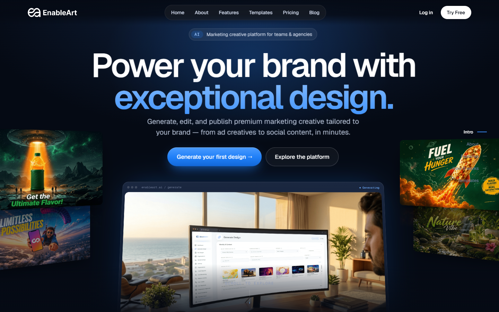
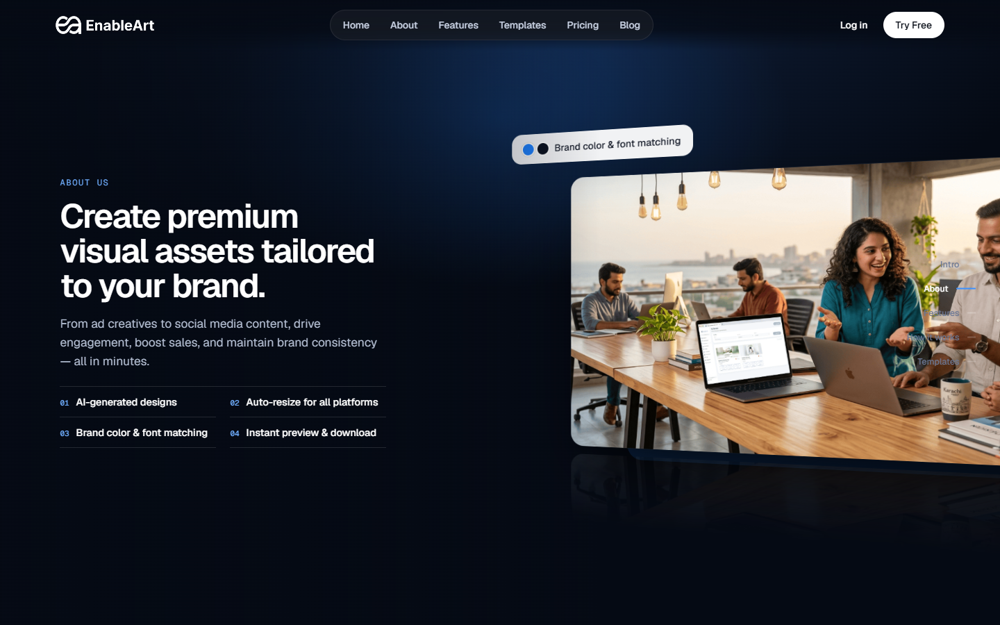
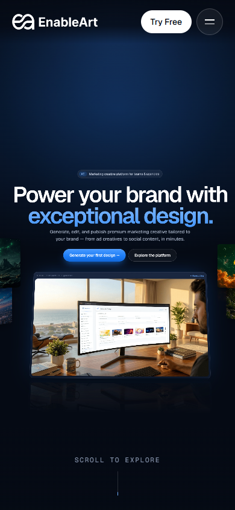
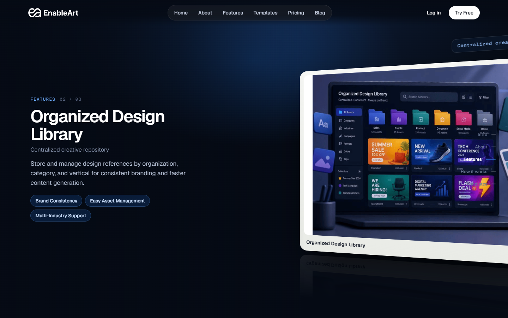
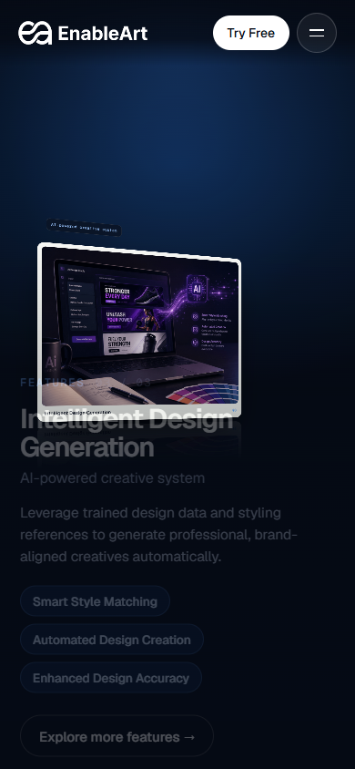
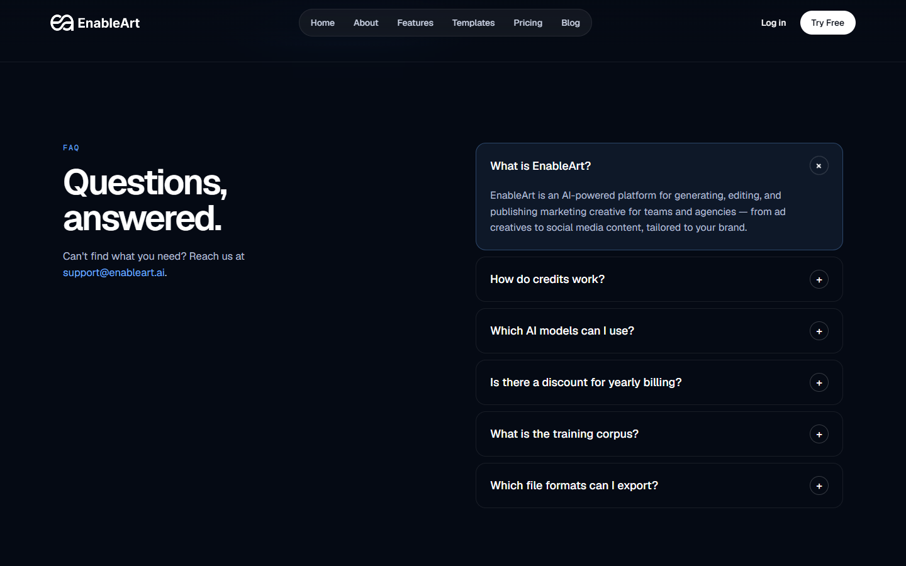
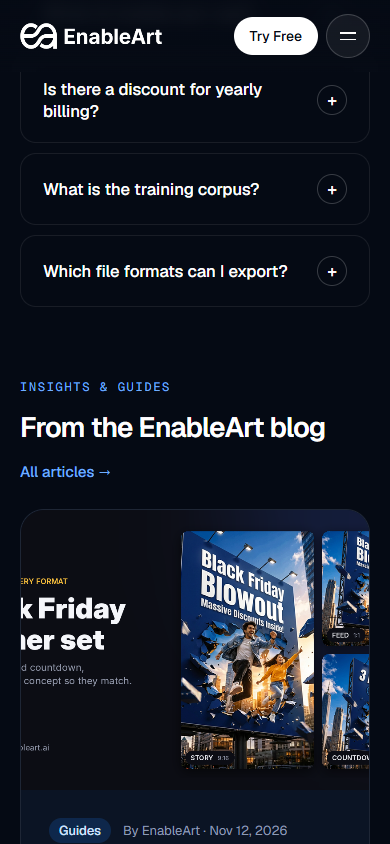

# EnableArt — Cinematic Redesign

A scroll-driven, 3D cinematic landing page for **EnableArt**, the AI marketing creative platform. It is a static site with no build step: one HTML file plus a small runtime script.



## Features

- **Scroll-driven 3D camera** – the page is a CSS-3D scene (`perspective` + `preserve-3d`). Scroll position drives a camera that flies through the hero, About, Features, How-it-works and Templates stages.
- **Fast opening** – the hero-to-About transition completes within roughly half a screen of scrolling, and the camera follows scroll with frame-rate-independent inertia.
- **Performance-minded render loop** – a single `requestAnimationFrame` loop reads cached layout metrics, caches the animated elements, and writes styles only when values change. The floor grid moves with a GPU transform instead of repainting.
- **Interactive 3D template carousel** – a rotating ring of template cards.
- **Pricing section** – Monthly/Yearly toggle, four plans, a highlighted recommended plan, and premium buttons (hover scale + glow + light sweep, press-down, keyboard focus ring).
- **FAQ accordion, blog card and footer.**
- **Responsive** – desktop and mobile layouts (hamburger menu below 900px).
- **Accessibility** – respects `prefers-reduced-motion` (the camera snaps between stages instead of flying; button motion is removed), visible keyboard focus states.

### Screenshots

| Desktop | Mobile |
|---|---|
|  |  |
|  |  |
|  |  |

## Project structure

```
.
├── index.html        # The page: markup, styles and the component script (<x-dc> format)
├── support.js        # "dc" runtime that renders index.html (generated file, do not edit)
├── vercel.json       # Static-hosting config for Vercel
├── package.json      # Convenience `npm start` script (no dependencies)
└── docs/screenshots/ # Screenshots used in this README
```

`index.html` loads `./support.js`. At runtime `support.js` loads React 18, ReactDOM and Babel Standalone from unpkg, then compiles and renders the `<x-dc>` template and its component script.

## Run locally

The page must be served over HTTP (opening the file directly with `file://` is not supported).

```bash
# Option 1 – Node
npm start            # serves on http://localhost:8080

# Option 2 – Python
python -m http.server 8080
```

Then open <http://localhost:8080>.

An internet connection is required: React/Babel come from unpkg, fonts from Google Fonts, and images from `https://www.enableart.ai/images/`.

## Deploy

It is a static site: import the repository into Vercel (or any static host) with **no build command** and the repository root as the output directory.

## Tweakable props

Declared in the `data-props` attribute of the script tag in `index.html`:

| Prop | Default | Description |
|---|---|---|
| `motion` | `auto` | `auto`, `full` or `reduced` |
| `inertia` | `0.14` | Scroll-follow smoothing (0.03–0.3; higher is snappier) |
| `showRail` | `true` | Side progress rail |
| `logoTreatment` | `white` | `white` or `original` |
| `billingDefault` | `monthly` | `monthly` or `yearly` |

Scroll pacing is controlled by `WARP_T` (how much of the scroll track the opening uses) and the track height (`height:1000vh`) in `index.html`.

## Known limitations

- Images, logo and fonts are loaded from external hosts; the page degrades if they are unreachable.
- The 3D scene is GPU-composited CSS; low-end phones may drop frames. Removing the header `backdrop-filter` is the first thing to try.

## Assets and licensing

Brand imagery and the EnableArt logo are served from enableart.ai and belong to EnableArt; they are not stored in this repository. No license is granted for reuse of the brand assets. No API keys or credentials are used or stored.
